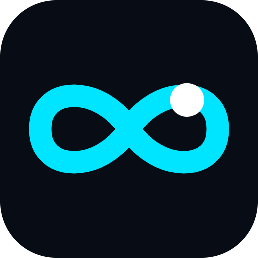
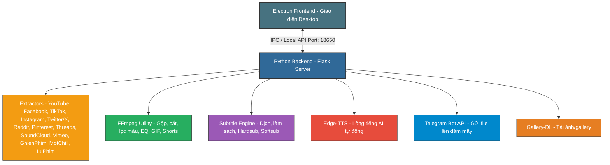

<p align="center">
  
</p>

<h1 align="center">🚀 EveryThingDownloader</h1>

<p align="center">
  <strong>Giải pháp tải đa phương tiện toàn năng, đa nền tảng, bảo mật tối đa và tự động hóa phát hành vượt trội</strong>
</p>

<p align="center">
  <a href="https://github.com/m3iK18dp/EveryThingDownloader/releases">
    
  </a>
  <a href="#">
    
  </a>
  <a href="#">
    
  </a>
  <a href="#">
    
  </a>
  <a href="LICENSE">
    
  </a>
</p>

---

## 🌟 Giới thiệu tổng quan

**EveryThingDownloader** không chỉ đơn thuần là một công cụ tải video. Đây là một **hệ sinh thái tải đa phương tiện hoàn chỉnh và bảo mật**, kết hợp hoàn hảo giữa hiệu năng xử lý mạnh mẽ của Backend Python (Flask) và trải nghiệm giao diện người dùng Desktop mượt mà, trực quan của Electron.

Ứng dụng **hỗ trợ đa nền tảng**: Windows, macOS và Linux — với quy trình CI/CD tự động hóa đóng gói và phát hành cho cả 3 hệ điều hành thông qua GitHub Actions.

Bên cạnh khả năng giải mã và tải xuống từ hàng loạt nền tảng lớn (Facebook, TikTok, Youtube, Instagram, Twitter/X, Reddit, Pinterest, Threads, SoundCloud, Vimeo, GhienPhim, MotChill, LuPhim...), dự án còn được trang bị **Build Tool độc quyền** hỗ trợ xáo trộn mã nguồn (AST Obfuscation), mã hóa nhị phân (PyArmor) và quản lý bản quyền (IP Lock, Expiry Date Lock, Hardware Fingerprint). Điều này cho phép bạn đóng gói ứng dụng thành tệp thực thi thương mại độc lập một cách an toàn nhất.

---

## ✨ Tính năng nổi bật

### 📥 1. Bộ Công Cụ Tải Xuống Đa Nguồn (Media Downloader)
* 🌐 **Mạng xã hội phổ biến**: 
  * **Facebook**: Tải video chất lượng HD/SD, Reels, Stories, Video từ các group công khai/riêng tư.
  * **TikTok**: Tự động bóc tách và tải video không logo (No Watermark), tải file nhạc nền riêng biệt, hỗ trợ slideshow ảnh.
  * **Instagram**: Hỗ trợ Reels, Stories, IGTV, bài viết carousel hình ảnh chất lượng gốc.
  * **YouTube**: Tải video mọi độ phân giải (360p → 4K), tự động ghép luồng DASH Adaptive (video-only + audio-only). Hỗ trợ YouTube Shorts, Music, Kids, Live, Clip, Embed.
  * **Twitter (X)** / **Reddit** / **Threads**: Tự động gộp luồng hình ảnh, video và âm thanh riêng lẻ thành tệp MP4 chất lượng cao nhất thông qua FFmpeg.
  * **Pinterest**: Tải ảnh/video chất lượng gốc qua `gallery-dl`.
  * **SoundCloud**: Tải nhạc trực tuyến chất lượng cao.
  * **Vimeo**: Hỗ trợ tải video chất lượng cao.
* 🎬 **Giải mã Web phim Việt Nam**: Tích hợp trình giải mã Iframe đa lớp và DNS Bypass (DoH qua Cloudflare/Google/AdGuard/OpenDNS) để truy cập và tải phim từ các trang bị chặn ISP: **GhienPhim**, **MotChill**, **LuPhim**, **PhimMoi**, **Phim1080**, **BiluTV**, **DongPhim**, **OPhim**, **GuPhim** và các trang WordPress DooPlay/Moviking tương tự.
* 📝 **Xử lý phụ đề thông minh (Subtitle Downloader & Translator)**:
  * **Trích xuất & Dịch thuật**: Tự động phát hiện và trích xuất phụ đề gốc của video; tích hợp công cụ tự động dịch phụ đề nước ngoài sang Tiếng Việt chuẩn xác qua Google Translate API.
  * **Hỗ trợ tải lên Sub tùy chọn**: Cho phép người dùng tải lên tệp phụ đề tự chọn (`.vtt`, `.srt`) từ máy tính cá nhân để nhúng vào video.
  * **Tùy chỉnh phong cách nhúng (Hardsub & Softsub)**:
    * **Hardsub (Burn-in)**: Ghi trực tiếp phụ đề lên khung hình video bằng bộ lọc FFmpeg. Tích hợp đồng bộ hóa phong cách từ bảng điều khiển UI (Font family, kích thước, màu chữ, viền chữ, bóng mờ và hộp nền). Tự động sử dụng font Arial hỗ trợ hiển thị tiếng Việt có dấu hoàn hảo trên Windows.
    * **Softsub (Muxed)**: Ghép luồng phụ đề mềm vào tệp đa phương tiện (MP4, MKV, WebM) mà không cần mã hóa lại video. Tự động gán cờ mặc định (Default Disposition) giúp các trình phát tự động bật phụ đề khi mở video.
  * **Làm sạch & Tối ưu hóa**: Luôn tự động xử lý làm sạch tệp phụ đề để xóa bỏ toàn bộ mã XML/HTML rác, bao gồm các thẻ mốc thời gian ẩn từng từ của YouTube (word-level timestamps); tự động gộp phụ đề dạng cuộn (rolling duplicate captions) tránh hiện tượng chữ bị lặp đè lên nhau, và ngắt dòng tối đa 10 từ/câu để bảo đảm tính dễ đọc.

### 🎧 2. Xử Lý Âm Thanh & Video Nâng Cao (Post-Processing)
* 🎨 **Bộ lọc màu Cinematic**: Áp dụng hiệu ứng màu sắc chuyên nghiệp lên video trước khi tải: Cyberpunk, Vintage, Noir, Enhance.
* 🎞️ **Xuất GIF & Shorts**: Chuyển đổi đoạn video thành ảnh GIF động chất lượng cao (palettegen), hoặc chuyển đổi video ngang thành dọc 9:16 (Shorts) với nền mờ tự động.
* 🎛️ **Cân bằng âm thanh (4-band EQ)**: Chỉnh Bass (60Hz), Low-Mid (500Hz), High-Mid (2kHz), Treble (10kHz) với các preset sẵn: Flat, Bass Boost, Vocal, Acoustic, Electronic, Lo-Fi.
* ⏩ **Thay đổi tốc độ phát**: Điều chỉnh tốc độ từ 0.25x đến 3x.
* 🎙️ **Hiệu ứng giọng nói (Voice FX)**: 8 preset giọng nói: Normal, Deep Bass, Bright, Concert Hall, Studio, Lo-Fi, Telephone, Underwater.
* 🗣️ **Lồng tiếng AI tự động (TTS Voiceover)**: Tích hợp `edge-tts` để tạo lồng tiếng tự động từ phụ đề video. Tổng hợp giọng nói song song (15 luồng), lập lịch tuần tự tránh chồng chéo, pha trộn PCM với âm thanh gốc (gốc 8%, lồng tiếng 150%).
* ✂️ **Cắt Video/Audio trước khi tải (Trimmer)**: Chọn điểm đầu/cuối trực tiếp trên thanh timeline bằng phím tắt `[` và `]`, chỉ tải đúng đoạn cần thiết.

### ☁️ 3. Tích Hợp Đám Mây & Lưu Trữ
* 📤 **Gửi file lên Telegram**: Tự động gửi file tải về trực tiếp đến Telegram Chat/Group/Channel thông qua Bot API (hỗ trợ sendVideo, sendAnimation, sendDocument).
* 📊 **Lịch sử tải xuống**: Lưu trữ toàn bộ lịch sử tải xuống vào SQLite database, hỗ trợ xem lại, tải lại hoặc xóa từng mục.

### 🛡️ 4. Hệ Thống Bảo Vệ Bản Quyền & Chống Dịch Ngược (Build Tool)
* 🧩 **AST Code Scrambling**: Tự động phân tích cây cú pháp trừu tượng (AST) của Python để xáo trộn tên biến, tên hàm, mã hóa chuỗi ký tự cục bộ, phá hỏng khả năng đọc hiểu của các công cụ dịch ngược (decompiler).
* 🔒 **PyArmor Binary Security**: Mã hóa nhị phân tệp thực thi Flask để bảo vệ tối đa thuật toán cốt lõi (3 cấp độ bảo vệ).
* 🎫 **Ràng buộc bản quyền (Licensing)**:
  * **IP Address Lock**: Khóa cứng ứng dụng chỉ được phép hoạt động trên các địa chỉ IP được cấp phép.
  * **Expiry Date Lock**: Thiết lập thời hạn dùng thử (Trial period).
  * **Hardware Fingerprint (Machine ID)**: Đăng ký bản quyền dựa trên dấu vân tay phần cứng duy nhất.
* 🚀 **Xuất bản GitHub Release**: Tự động tạo tag, commit và push trực tiếp từ giao diện Build GUI, kích hoạt CI/CD pipeline.

### 💻 5. Electron Desktop UX/UI Cao Cấp
* 🎨 **Giao diện Glassmorphic**: Cửa sổ không viền (Frameless) hiện đại, bo góc Windows 11, hệ màu Dark/Light Mode với chuyển đổi mượt mà (View Transitions API).
* 🎭 **Tùy biến giao diện (UI Customizer)**: 10+ bảng màu accent (Emerald, Orchid, Amber, Purple, Rose...), tùy chỉnh bo góc, độ mờ kính (Glass Blur), font chữ, kích thước, hiệu ứng nền tương tác (Star Grid, Ripples, Sparkles, Sound Reactive Grid).
* 📥 **Khay hệ thống (System Tray)**: Thu nhỏ chạy nền, khởi động cùng Windows, menu chuột phải đa năng (Restart Backend, mở thư mục tải, mở trên trình duyệt).
* 🔄 **Single-Instance Restoring**: Ngăn chạy trùng lặp, tự động khôi phục cửa sổ khi nhấp đúp biểu tượng.
* 🔔 **Auto-Update đa nền tảng**: Kiểm tra phiên bản mới từ GitHub, tải và cài đặt tự động (.exe cho Windows, .dmg cho macOS theo kiến trúc arm64/x64, .AppImage cho Linux).
* 📋 **Tự động nhận diện Link Clipboard**: Quét clipboard mỗi 1.5 giây, phát hiện URL video từ 12+ nền tảng, hiển thị thông báo Toast để phân tích nhanh.
* ⌨️ **Phím tắt toàn diện**: 20+ phím tắt cho Video Player (Space, M, ←→, ↑↓, F, [, ], 0-9, < >, D), Audio Player, Image Viewer (R, +/-, 0), Text/Subtitle Viewer.

### 🖥️ 6. Trình Xem Trước Đa Phương Tiện (Previewer)
* 🎬 **Video Player tùy chỉnh**: Trình phát video với DASH Adaptive Streaming proxy (ghép video-only + audio-only trực tiếp), thanh điều khiển tùy chỉnh, Picture-in-Picture, A-B Loop, hiệu ứng Ambient Glow.
* 🎵 **Audio Player**: Hiệu ứng sóng nhạc trực quan (Waveform Visualizer) bằng Web Audio API, đĩa than Vinyl xoay động, bảng điều khiển EQ/Speed/Voice FX.
* 🖼️ **Image Viewer**: Phóng to (0.5x → 5x), xoay 90°, kéo pan khi zoom, điều hướng ảnh ←→.
* 📄 **Subtitle/Text Viewer**: Hiển thị transcript đồng bộ thời gian thực, tìm kiếm trong transcript, Word Wrap, phóng to/thu nhỏ font.
* 🌐 **Webpage Viewer**: Hiển thị nội dung HTML trong sandbox iframe an toàn (CORS bypass).
* 🎭 **3 chế độ Fullscreen**: Normal → Theater (Web Fullscreen) → Native Fullscreen, tự động ẩn thanh điều khiển và con trỏ sau 3 giây.

---

## 🛠️ Sơ đồ Kiến trúc & Luồng Hoạt động



---

## ⚙️ Công Nghệ Sử Dụng

* **Core Backend**: Python 3.12, Flask 3.0.3, Flask-CORS, SQLite (lưu lịch sử tải + cấu hình), PyInstaller, PyArmor.
* **Core Frontend**: Electron (v31+), HTML5, Vanilla CSS (Glassmorphic Dark/Light Mode), JavaScript (ES6+), Web Audio API, View Transitions API.
* **Download Engine**: `yt-dlp` + `yt-dlp-ejs` (video/audio), `gallery-dl` (ảnh/gallery), `curl-cffi` (bypass Cloudflare/anti-bot).
* **Xử lý đa phương tiện**: FFmpeg/FFprobe (qua `static-ffmpeg`) — gộp luồng, cắt, lọc màu, EQ, tốc độ, voice FX, hardsub, softsub, GIF, Shorts.
* **AI & Dịch thuật**: `edge-tts` (lồng tiếng TTS), Google Translate API (dịch phụ đề batch).
* **JS Runtime**: QuickJS, Deno, Node (cho yt-dlp signature handling).
* **Phát hành & Tự động hóa**: GitHub Actions (CI/CD multi-platform), Electron Builder, NSIS/MSI (Windows), DMG/ZIP/PKG (macOS), AppImage/tar.gz/DEB/RPM (Linux).
* **Containerization**: Docker (`python:3.10-slim`) + Docker Compose hỗ trợ triển khai Web Server và Build GUI trên container.

---

## 🚀 Hướng Dẫn Phát Triển (Development)

### Yêu cầu hệ thống
* **Python**: `3.12.x` trở lên
* **Node.js**: `20.x` hoặc `22.x`
* **FFmpeg**: Được tự động cài đặt qua thư viện `static-ffmpeg` (không cần cài đặt thủ công).

### Thiết lập môi trường chạy thử (Dev Mode)

1. **Khởi chạy Python Backend**:
   ```bash
   # Tạo và kích hoạt môi trường ảo
   python -m venv venv
   source venv/bin/activate  # Trên Linux/macOS
   # Hoặc trên Windows:
   # venv\Scripts\activate

   # Cài đặt thư viện dependencies
   pip install -r requirements.txt

   # Khởi chạy Flask Server (chế độ dev)
   python app.py
   ```

2. **Khởi chạy Electron Frontend**:
   ```bash
   cd electron
   npm install
   npm run dev
   ```

### 🐳 Triển khai bằng Docker

```bash
# Khởi chạy Web Server
docker-compose up app

# Khởi chạy Build Tool GUI
docker-compose up builder

# Khởi chạy cả hai
docker-compose up
```

---

## 📦 Đóng Gói & Phát Hành (Production Build)

EveryThingDownloader tích hợp bộ công cụ đóng gói thông minh hỗ trợ cả giao diện đồ họa Web GUI trực quan lẫn dòng lệnh CLI mạnh mẽ, và menu tương tác (Interactive CLI Dashboard).

### Cách 1: Sử dụng Web Build GUI (Khuyên dùng)
1. Khởi chạy máy chủ Build GUI:
   ```bash
   python build_tool/builder_cli.py --gui
   ```
2. Truy cập địa chỉ hiển thị trên màn hình (mặc định `http://127.0.0.1:18651/`) bằng trình duyệt web.
3. Tùy chỉnh các tham số bảo mật:
   - **Obfuscate Code**: Bật xáo trộn mã nguồn.
   - **IP Lock / Expiry Date / Machine ID**: Nhập cấu hình bản quyền tương ứng.
4. Bấm **Start Build** để tiến hành đóng gói tự động.

### Cách 2: Sử dụng dòng lệnh CLI
```bash
# Chỉ build bản chạy trên trình duyệt Web (Web Target) có xáo trộn code
python build_tool/builder_cli.py --target web --obfuscate

# Build đầy đủ bản Desktop App (Installer + Portable trên Windows, DMG/ZIP trên macOS, AppImage/tar.gz trên Linux)
python build_tool/builder_cli.py --target desktop --obfuscate --name EveryThingDownloader --version 1.0.0

# Build cả Web Binary lẫn Desktop App
python build_tool/builder_cli.py --target both --obfuscate
```

### Cách 3: Sử dụng Interactive CLI Menu Dashboard
```bash
# Khởi chạy menu tương tác không cần tham số
python build_tool/builder_cli.py
```
Hiển thị bảng điều khiển color-coded cho phép:
- Chọn mục tiêu build (Web / Desktop / Both)
- Cấu hình Code Protection (PyArmor, AST Scrambling, Dead Code, Anti-Debug...)
- Thiết lập Licensing (IP Lock, Expiry Date, Machine ID Lock)
- Tùy chỉnh metadata (App Name, Version, Company, Icon...)
- Lưu / Tải cấu hình từ JSON file
- Xem Hardware Machine ID của máy hiện tại

> **Lưu ý**: PyInstaller không hỗ trợ cross-compilation. Cần build trên hệ điều hành gốc tương ứng (Windows build trên Windows, macOS build trên macOS, Linux build trên Linux). GitHub Actions CI/CD tự động hóa quy trình này cho cả 3 nền tảng.

---

## ☁️ Quy Trình Tự Động Hóa Phát Hành (Automated Release CI/CD)

Dự án sử dụng **GitHub Actions** để tự động hóa hoàn toàn quy trình đóng gói và phát hành ứng dụng trên **cả 3 nền tảng** (Windows, macOS, Linux) mỗi khi có phiên bản mới:

1. **Gắn thẻ phiên bản**:
   ```bash
   git tag v1.0.1
   git push origin v1.0.1
   ```
2. **Biên dịch đa nền tảng trên mây**: GitHub Actions sử dụng **matrix strategy** để song song kích hoạt 3 máy ảo (`windows-latest`, `macos-latest`, `ubuntu-latest`), mỗi máy tự động:
   - Tải mã nguồn, cài đặt Python 3.12 và Node.js 20
   - Biên dịch backend thành binary (`.exe` trên Windows, binary trên macOS/Linux)
   - Đóng gói Electron installer/portable cho từng nền tảng
   - Đổi tên Web Binary kèm hậu tố nền tảng (ví dụ: `EveryThingDownloader-Web-1.0.0-Windows.exe`, `-macOS`, `-Linux`)
3. **Tạo Release tự động**: Tổng hợp toàn bộ artifact từ 3 nền tảng, tính SHA-256 checksum cho từng file, tạo Release Notes chi tiết và đẩy lên cả kho riêng tư (Private) lẫn kho công khai (Public).
4. **Đẩy cập nhật**: Hệ thống tự động cập nhật file `update.json` trên kho công khai chứa thông tin phiên bản mới nhất cùng đường dẫn tải về. Ứng dụng Electron của người dùng sẽ tự động nhận diện bản cập nhật tiếp theo thông qua tính năng **Auto-Update** tích hợp sẵn.

---

## 📝 Giấy Phép & Bản Quyền

Dự án được phát hành theo giấy phép **MIT License**. 
Bản quyền thuộc về **EveryThingDownloader Team © 2026**.
