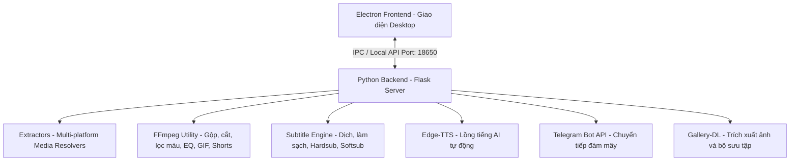

# Meikova Harvest

<div align="center">


[](https://github.com/Meikova/meikova-harvest/releases)
[](https://github.com/Meikova/meikova-harvest)
[](https://www.python.org/)
[](https://www.electronjs.org/)
[](LICENSE)

**Giải pháp trích xuất và tải đa phương tiện toàn năng, đa nền tảng, bảo vệ mã nguồn AST và tự động hóa phát hành CI/CD.**

[Tải Bản Cài Đặt](https://github.com/Meikova/meikova-harvest/releases) | [Hướng Dẫn Build Tool](docs/BUILD_GUIDE.md) | [Báo Lỗi](https://github.com/Meikova/meikova-harvest/issues)

</div>

---

## 1. Tổng quan hệ thống

Meikova Harvest là hệ sinh thái tải và xử lý đa phương tiện hoàn chỉnh, kết hợp giữa hiệu năng xử lý backend Python (Flask) và giao diện desktop Electron mượt mà.

- **Đa nền tảng**: Hỗ trợ đầy đủ Windows, macOS và Linux với quy trình CI/CD tự động đóng gói trên GitHub Actions.
- **Trích xuất đa nguồn**: Hỗ trợ giải mã và tải nội dung từ các nền tảng mạng xã hội lớn (YouTube, Facebook, TikTok, Instagram, Twitter/X, Reddit, Pinterest, Threads, SoundCloud, Vimeo) và các trang web phim trực tuyến.
- **Bảo mật và thương mại hóa**: Tích hợp công cụ độc quyền hỗ trợ xáo trộn mã nguồn (AST Obfuscation), mã hóa nhị phân (PyArmor) và ràng buộc giấy phép (IP Lock, Expiry Date Lock, Hardware Fingerprint).

---

## 2. Tính năng nổi bật

### Bộ công cụ tải xuống đa nguồn

- **Mạng xã hội phổ biến**:
  - Facebook: Tải video HD/SD, Reels, Stories, video nhóm công khai và riêng tư.
  - TikTok: Tự động tách và tải video không watermark, tách nhạc nền riêng, hỗ trợ slideshow ảnh.
  - Instagram: Hỗ trợ Reels, Stories, IGTV và bài viết carousel hình ảnh chất lượng gốc.
  - YouTube: Tải mọi độ phân giải (360p đến 4K), tự động ghép luồng DASH Adaptive (video-only + audio-only). Hỗ trợ Shorts, Music, Live stream.
  - Twitter (X) / Reddit / Threads: Tự động gộp luồng hình ảnh, video và âm thanh qua FFmpeg.
  - Pinterest: Tải ảnh và bộ sưu tập chất lượng gốc qua gallery-dl.
  - SoundCloud & Vimeo: Tải trực tiếp âm thanh và video chất lượng cao.
- **Giải mã trang phim và website hạn chế**: Tích hợp bộ giải mã iframe đa lớp và DNS over HTTPS (DoH qua Cloudflare, Google, AdGuard, OpenDNS) vượt qua rào cản mạng chặn tên miền.
- **Xử lý phụ đề thông minh**:
  - Trích xuất và dịch thuật: Tự động phát hiện phụ đề gốc và dịch sang tiếng Việt qua Google Translate API.
  - Nhúng phụ đề linh hoạt:
    - Hardsub (Burn-in): Ghi trực tiếp phụ đề lên khung hình video bằng bộ lọc FFmpeg, tùy biến font chữ, kích cỡ, màu sắc, bóng mờ và viền nét.
    - Softsub (Muxed): Ghép luồng phụ đề mềm vào MP4, MKV, WebM không cần mã hóa lại toàn bộ video.
  - Làm sạch dữ liệu: Tự động làm sạch thẻ XML/HTML rác, xóa mốc thời gian thừa cấp độ từ (word-level timestamps), chống trùng lặp dòng cuộn và tự ngắt dòng chuẩn tối đa 10 từ/câu.

### Xử lý âm thanh và video nâng cao

- **Bộ lọc màu Cinematic**: Áp dụng hiệu ứng màu sắc chuyên nghiệp (Cyberpunk, Vintage, Noir, Enhance) trực tiếp trong luồng xuất.
- **Xuất ảnh động GIF và định dạng Shorts**: Chuyển đổi video sang GIF chất lượng cao qua palettegen, hoặc chuyển đổi video ngang thành định dạng dọc 9:16 có nền mờ tự động.
- **Cân bằng âm thanh (4-band EQ)**: Tùy chỉnh dải tần Bass (60Hz), Low-Mid (500Hz), High-Mid (2kHz), Treble (10kHz) kèm preset: Flat, Bass Boost, Vocal, Acoustic, Electronic, Lo-Fi.
- **Điều chỉnh tốc độ và hiệu ứng giọng nói**: Thay đổi tốc độ phát từ 0.25x đến 3x; tích hợp 8 preset Voice FX (Normal, Deep Bass, Bright, Concert Hall, Studio, Lo-Fi, Telephone, Underwater).
- **Lồng tiếng AI tự động (TTS Voiceover)**: Sử dụng edge-tts tạo giọng lồng tiếng tự động từ phụ đề, xử lý song song và hòa trộn cân đối với âm thanh nền.
- **Cắt đoạn chính xác (Trimmer)**: Chọn điểm đầu và điểm cuối trên timeline qua phím tắt `[` và `]` để chỉ tải đoạn cần thiết.

### Tích hợp đám mây và lưu trữ

- **Gửi tệp lên Telegram**: Tự động chuyển tiếp tệp tải về tới Telegram Chat/Group/Channel qua Bot API (sendVideo, sendAnimation, sendDocument).
- **Nhật ký tải xuống**: Lưu trữ lịch sử tải xuống trong cơ sở dữ liệu SQLite, hỗ trợ tra cứu, tải lại và quản lý dung lượng.

### Hệ thống bảo vệ bản quyền và chống dịch ngược

- **AST Code Scrambling**: Tự động phân tích cây cú pháp trừu tượng (AST) của Python để đổi tên biến, tên hàm, mã hóa chuỗi ký tự, ngăn chặn các công cụ decompiler.
- **PyArmor Binary Security**: Mã hóa nhị phân tệp thực thi Flask để bảo vệ thuật toán cốt lõi.
- **Ràng buộc giấy phép (Licensing)**:
  - IP Address Lock: Khóa ứng dụng theo dải địa chỉ IP cho phép.
  - Expiry Date Lock: Thiết lập thời hạn dùng thử và tự động khóa khi hết hạn.
  - Hardware Fingerprint: Định danh thiết bị dựa trên phần cứng (Mainboard UUID, CPU ID).

### Trải nghiệm Desktop Electron

- **Giao diện Frameless**: Cửa sổ không viền hiện đại, bo góc Windows 11, chế độ Dark/Light chuyển đổi mượt mà với View Transitions API.
- **Khay hệ thống (System Tray)**: Chạy nền tiết kiệm tài nguyên, khởi động cùng hệ thống, menu điều khiển nhanh.
- **Nhận diện liên kết Clipboard**: Tự động quét clipboard phát hiện URL hỗ trợ và gợi ý phân tích ngay lập tức.
- **Trình xem trước đa phương tiện tích hợp**: Hỗ trợ xem trước video qua DASH proxy, nghe âm thanh với waveform visualizer, xem ảnh thu phóng pan/zoom và kiểm tra nội dung phụ đề trực tiếp.

---

## 3. Kiến trúc hệ thống và luồng dữ liệu



---

## 4. Công nghệ sử dụng

- **Core Backend**: Python 3.12, Flask 3.0.3, Flask-CORS, SQLite, PyInstaller, PyArmor.
- **Core Frontend**: Electron 31+, HTML5, Vanilla CSS (OKLCH Theming), JavaScript (ES Modules), Web Audio API.
- **Media Engine**: yt-dlp, yt-dlp-ejs, gallery-dl, static-ffmpeg (FFmpeg/FFprobe).
- **Phụ trợ**: curl-cffi (bảo vệ chống chặn), edge-tts, Google Translate API.
- **Tự động hóa phát hành**: GitHub Actions, Electron Builder, NSIS (Windows), DMG (macOS), AppImage/DEB (Linux).

---

## 5. Hướng dẫn phát triển (Development)

### Yêu cầu hệ thống

- Python 3.12+
- Node.js 20+ hoặc 22+
- FFmpeg (được tự động cài đặt qua package static-ffmpeg)

### Khởi chạy môi trường thử nghiệm

1. **Khởi chạy Python Backend**:

```bash
python -m venv venv
# Windows:
.\venv\Scripts\activate
# Linux/macOS:
# source venv/bin/activate

pip install -r requirements.txt
python app.py
```

2. **Khởi chạy Electron Frontend**:

```bash
cd electron
npm install
npm run dev
```

---

## 6. Đóng gói và phát hành (Production Build)

### Cách 1: Sử dụng Web Build GUI

```bash
python build_tool/builder_cli.py --gui
```

Mở trình duyệt tại `http://127.0.0.1:18651/`, thiết lập tham số bảo mật và nhấn Start Build.

### Cách 2: Sử dụng dòng lệnh CLI

```bash
# Build bản Web:
python build_tool/builder_cli.py --target web --obfuscate

# Build ứng dụng Desktop đầy đủ:
python build_tool/builder_cli.py --target desktop --obfuscate --name "Meikova Harvest" --version 1.0.0

# Build cả hai mục tiêu:
python build_tool/builder_cli.py --target both --obfuscate
```

### Cách 3: Interactive CLI Dashboard

```bash
python build_tool/builder_cli.py
```

---

## 7. Tự động hóa phát hành (CI/CD)

Dự án sử dụng GitHub Actions tự động hóa hoàn toàn quy trình đóng gói cho cả 3 nền tảng:

```bash
git tag v1.0.0
git push origin v1.0.0
```

GitHub Actions matrix sẽ kích hoạt đồng thời 3 môi trường ảo (`windows-latest`, `macos-latest`, `ubuntu-latest`) để tạo binary, tính mã băm SHA-256 và tạo bản phát hành GitHub Release kèm file cấu hình `update.json`.

---

## 8. Giấy phép bản quyền (License)

Dự án được phát hành theo giấy phép **MIT License**.
Bản quyền thuộc về **Meikova Harvest Team © 2026**.

---

## 9. Hệ sinh thái Meikova

- [Meikova Harvest](https://github.com/Meikova/meikova-harvest) - Hệ sinh thái trích xuất và tải đa phương tiện đa nền tảng.
- [Meikova Loop](https://github.com/Meikova/meikova-loop) - DJ mashup và infinite soundscape engine chạy trên web, desktop và mobile.
- [Meikova Relay](https://github.com/Meikova/meikova-relay) - Điều khiển máy tính từ xa độ trễ thấp, outbound-only.
- [Meikova Auth](https://github.com/Meikova/meikova-auth) - Cổng xác thực tập trung, Universal SSO Ed25519 và quản lý danh tính đa nền tảng.
- [Meikova Balance](https://github.com/Meikova/meikova-balance) - Quản lý tài chính cá nhân, chia hóa đơn nhóm và trợ lý AI đa tầng.
- [Meikova Campus](https://github.com/Meikova/meikova-campus) - Nền tảng thương mại khóa học, phân quyền Google Drive tự động và LMS trực tuyến.
- [Meikova Exchange](https://github.com/Meikova/meikova-exchange) - Sàn giao dịch B2B cho dự án phần mềm, mã nguồn và tài sản số.
- [Meikova Traverse](https://github.com/Meikova/meikova-traverse) - Trình duyệt tệp tin cục bộ, SFTP, WebDAV và quản lý lưu trữ đa nền tảng.
- [Meikova Shield](https://github.com/Meikova/meikova-shield) - Hệ thống phòng thủ an ninh mạng và phát hiện web defacement bằng học máy lai ghép.
- [Meikova Vision](https://github.com/Meikova/meikova-vision) - Bộ công cụ xử lý ảnh RAW, ghép đa phơi sáng HDR và tone mapping chuyên nghiệp.
- [Meikova Flow](https://github.com/Meikova/meikova-flow) - Động cơ trích xuất, biến đổi, nạp dữ liệu (ETL) và tự động hóa luồng báo cáo.
