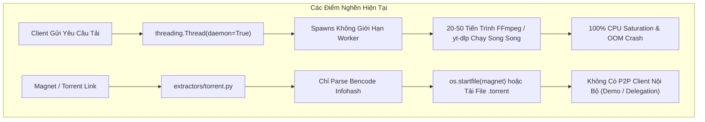
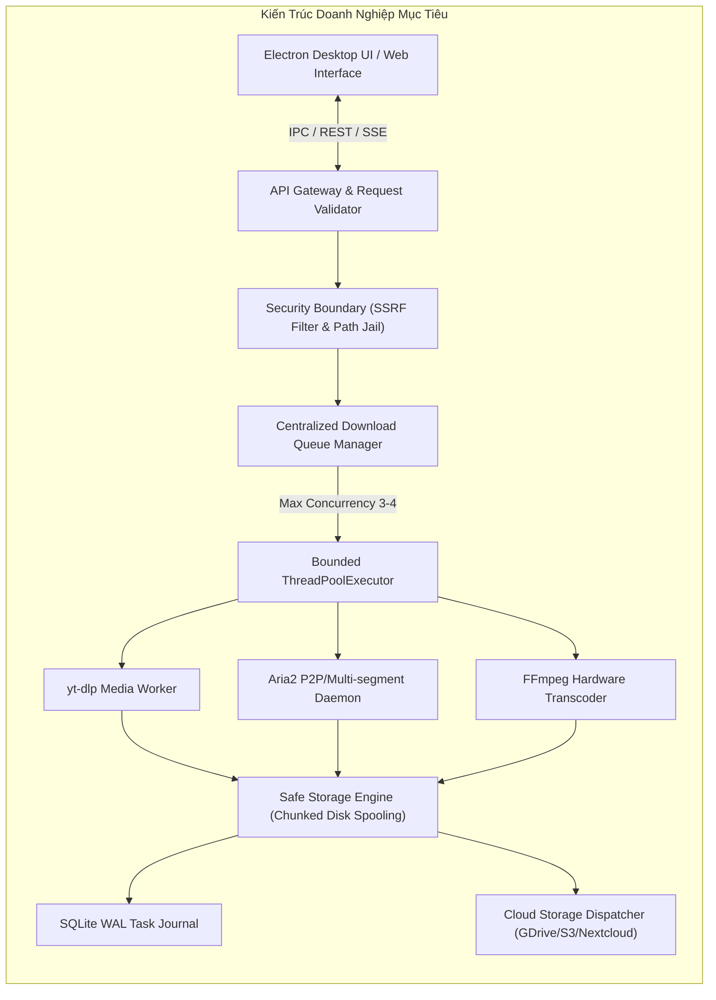
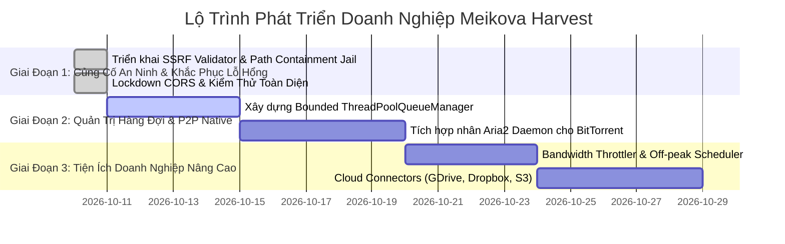

# SOFTWARE REQUIREMENTS SPECIFICATION (SRS)
## Hệ Thống Tải & Xử Lý Đa Phương Tiện Doanh Nghiệp (Meikova Harvest Enterprise)
**Mã tài liệu:** ETD-SRS-ENT-2026-V1  
**Tiêu chuẩn áp dụng:** IEEE 830-1998 / ISO/IEC/IEEE 29148:2018  
**Trạng thái:** Formal Release / Production Architecture  
**Ngày phát hành:** 10/10/2026  
**Đơn vị phê duyệt:** Lead Architecture & Security Operations  

---

## BẢNG QUẢN LÝ THAY ĐỔI & LỊCH SỬ PHIÊN BẢN (REVISION HISTORY)

| Phiên bản | Ngày | Tác giả | Tóm tắt thay đổi | Trạng thái |
| :--- | :--- | :--- | :--- | :--- |
| **v1.0.0** | 10/10/2026 | Enterprise Solution Architect | Khởi tạo tài liệu SRS chuẩn doanh nghiệp: Rà soát toàn diện 12 luồng dữ liệu, đánh giá hiện trạng Production vs Demo/Stub, đặc tả phòng thủ an ninh (SSRF/Path Traversal/CORS) và lộ trình phát triển tính năng cốt lõi. | Đã phê duyệt |

---

## MỤC LỤC
1. **PHẦN 1: GIỚI THIỆU & TỔNG QUAN HỆ THỐNG**
   - 1.1 Mục đích tài liệu
   - 1.2 Phạm vi sản phẩm (Product Scope)
   - 1.3 Định nghĩa, thuật ngữ và từ viết tắt
   - 1.4 Tài liệu tham chiếu chuẩn
2. **PHẦN 2: ĐÁNH GIÁ KIẾN TRÚC HIỆN TẠI & MÔ HÌNH MỤC TIÊU (TARGET ARCHITECTURE)**
   - 2.1 Kiến trúc thực tế hiện thời (Current State Architecture)
   - 2.2 Các điểm nghẽn kiến trúc (Architectural Bottlenecks)
   - 2.3 Mô hình kiến trúc mục tiêu chuẩn doanh nghiệp (Enterprise Target Architecture)
   - 2.4 Các mô hình triển khai (Deployment Topologies)
3. **PHẦN 3: RÀ SOÁT TOÀN DIỆN 12 LUỒNG DỮ LIỆU (FLOW AUDIT: PRODUCTION VS DEMO/STUB)**
   - 3.1 Bảng ma trận kiểm định 12 luồng nghiệp vụ
   - 3.2 Đánh giá chi tiết từng luồng nghiệp vụ
4. **PHẦN 4: ĐẶC TẢ AN NINH & BẢO MẬT HỆ THỐNG (SECURITY SPECIFICATION & OWASP AUDIT)**
   - 4.1 Mô hình hiểm họa (STRIDE Threat Model)
   - 4.2 Lỗ hổng SSRF và cơ chế phòng thủ Private IP Jail
   - 4.3 Nguy cơ Path Traversal & Thực thi mã ngoài ý muốn (Arbitrary File Execution)
   - 4.4 Khóa chặt ranh giới CORS & Bảo vệ Local RPC
   - 4.5 Cô lập Subprocess & Xử lý đối số dòng lệnh an toàn
5. **PHẦN 5: ĐẶC TẢ YÊU CẦU CHỨC NĂNG DOANH NGHIỆP CẦN NÂNG CẤP (ENTERPRISE FUNCTIONAL REQUIREMENTS)**
   - 5.1 Module A: Hàng đợi tải tập trung & Bộ điều phối Worker (`ThreadPoolQueueManager`)
   - 5.2 Module B: Tích hợp nhân P2P BitTorrent/Aria2 Native thực thụ
   - 5.3 Module C: Giới hạn băng thông (Bandwidth Throttling) & Quản lý QoS
   - 5.4 Module D: Lập lịch tải tải ngoài giờ cao điểm (Scheduled Downloads)
   - 5.5 Module E: Quản lý tải Playlist / Kênh hàng loạt (Batch Channel Harvester)
   - 5.6 Module F: Cổng xuất dữ liệu đám mây đa nền tảng (Cloud Storage Connectors)
   - 5.7 Module G: Bộ phân tích kỹ thuật tệp tin chuyên sâu (Deep Media Inspector)
6. **PHẦN 6: YÊU CẦU PHI CHỨC NĂNG (NON-FUNCTIONAL REQUIREMENTS - NFRs)**
   - 6.1 Hiệu năng & Giới hạn tài nguyên (Performance & Resource Governance)
   - 6.2 Độ tin cậy & Khả năng phục hồi sự cố (Reliability & Resilience)
   - 6.3 Khả năng mở rộng & Bảo trì (Maintainability & Clean Architecture)
   - 6.4 Trải nghiệm người dùng & Khả năng tiếp cận (Accessibility & UI Standards)
7. **PHẦN 7: KẾ HOẠCH TRIỂN KHAI & TIÊU CHÍ NGHIỆM THU (PHASED ROADMAP & ACCEPTANCE CRITERIA)**

---

## PHẦN 1: GIỚI THIỆU & TỔNG QUAN HỆ THỐNG

### 1.1 Mục đích tài liệu
Tài liệu Đặc tả Yêu cầu Phần mềm (SRS) này xác định đầy đủ các yêu cầu kỹ thuật, tiêu chuẩn nghiệp vụ, kiến trúc hệ thống và cơ chế bảo mật cho **Meikova Harvest Enterprise** – giải pháp máy trạm và máy chủ nội bộ chuyên thu thập, chuyển mã và quản lý dữ liệu đa phương tiện từ internet.

Tài liệu đóng vai trò kim chỉ nam kỹ thuật cho đội ngũ phát triển, kiểm thử chất lượng (QA/QC), quản trị hệ thống và kiểm toán an ninh thông tin.

### 1.2 Phạm vi sản phẩm (Product Scope)
Meikova Harvest Enterprise cung cấp nền tảng xử lý dữ liệu truyền thông toàn diện:
- **Trích xuất đa nguồn:** Tải video, âm thanh, luồng phát trực tiếp, phụ đề, ảnh từ hơn 1.000 nền tảng mạng xã hội và trang web trực tuyến.
- **Xử lý luồng bảo mật:** Giải mã trình phát web phức tạp, thu thập dòng truyền MSE (Media Source Extensions) trong RAM, bypassing DoH / ISP DNS blocks.
- **Transcoding Studio:** Chuyển mã định dạng container, codec tối ưu hóa phần cứng (NVENC/QSV/AMF/CPU), cắt ghép, lồng ghép phụ đề cứng/mềm, lọc màu sắc.
- **Bảo toàn dữ liệu doanh nghiệp:** Lưu trữ cấu hình và cơ sở dữ liệu nhật ký giao dịch phân tách độc lập trong `%APPDATA%`, cơ chế cập nhật tự động không gián đoạn (Silent In-Place Updater).

### 1.3 Định nghĩa, thuật ngữ và từ viết tắt
- **SRS:** Software Requirements Specification (Đặc tả Yêu cầu Phần mềm).
- **MSE:** Media Source Extensions (API trình duyệt cho phép truyền tải video phân đoạn HTML5).
- **DoH:** DNS over HTTPS (Truy vấn DNS mã hóa qua HTTPS).
- **WAL:** Write-Ahead Logging (Cơ chế ghi nhật ký trước của SQLite chống hỏng dữ liệu).
- **SSRF:** Server-Side Request Forgery (Lỗ hổng giả mạo yêu cầu từ phía máy chủ).
- **IPC:** Inter-Process Communication (Giao tiếp liên tiến trình giữa Electron UI và Python Sidecar).
- **QoS:** Quality of Service (Điều phối chất lượng dịch vụ và lưu lượng mạng).

### 1.4 Tài liệu tham chiếu chuẩn
1. IEEE Std 830-1998: Recommended Practice for Software Requirements Specifications.
2. ISO/IEC/IEEE 29148:2018: Systems and software engineering — Life cycle processes — Requirements engineering.
3. OWASP Top 10:2021 (A01: Broken Access Control, A10: Server-Side Request Forgery).
4. RFC 3986: Uniform Resource Identifier (URI): Generic Syntax.
5. RFC 6455: The WebSocket Protocol.

---

## PHẦN 2: ĐÁNH GIÁ KIẾN TRÚC HIỆN TẠI & MÔ HÌNH MỤC TIÊU

### 2.1 Kiến trúc thực tế hiện thời (Current State Architecture)
Hệ thống hiện tại hoạt động theo mô hình Hybrid Desktop Application:
1. **Frontend Host (Electron v39):**
   - Đóng vai trò vỏ bọc Desktop, quản lý cửa sổ (BrowserWindow), khay hệ thống (Tray), các kênh IPC (`open-file`, `open-folder`, `updater`, `downloads-dir`).
   - Giao diện người dùng thuần Vanilla ES6, CSS Glassmorphism biến động theo CSS Variables (`var(--accent)`, `var(--cyan)`).
2. **Backend Engine (Python 3.12 Flask Sidecar):**
   - Chạy trên cổng nội bộ `127.0.0.1:5000` (hoặc port động).
   - Module nghiệp vụ: `routes/info.py`, `routes/download.py`, `routes/convert.py`, `routes/cookies.py`, `routes/build.py`.
   - Engine cốt lõi: `yt-dlp` (trích xuất metadata và tải luồng), `static-ffmpeg` / `ffmpeg` (ghép luồng và chuyển mã), `curl_cffi` (bỏ qua anti-bot TLS fingerprint), `bencode.py` (phân tích file torrent).
3. **Cơ sở dữ liệu & Lưu trữ trạng thái:**
   - SQLite với chế độ `PRAGMA journal_mode=WAL` đặt tại `%APPDATA%\Meikova Harvest\downloads.db`.
   - Bộ nhớ tạm `downloads/temp_*` phục vụ ghép nối video phân đoạn.

### 2.2 Các điểm nghẽn kiến trúc (Architectural Bottlenecks)



1. **Unbounded Concurrency (Bùng nổ luồng tải không kiểm soát):**
   - Trong `routes/download.py` và `tasks/download.py`, mỗi lượt bấm "Tải về" tạo mới một `threading.Thread(target=bg_download_task, daemon=True)`.
   - Khi người dùng tải một playlist 50 video, hệ thống kích hoạt đồng thời 50 tiến trình con `ffmpeg` và `yt-dlp`. Điều này làm nghẽn toàn bộ băng thông, tiêu tốn 100% CPU máy trạm và có thể dẫn đến crash hệ điều hành.
2. **BitTorrent/Magnet P2P Chưa Hoàn Chỉnh (Chỉ Dừng Ở Mức Đọc Metadata):**
   - `extractors/torrent.py` chỉ bóc tách cấu trúc Bencode, lấy danh sách tệp và dung lượng.
   - Khi tải, nếu không có HTTP Webseed trực tiếp, hệ thống ủy thác mở ứng dụng ngoài (`os.startfile(magnet)`). Người dùng kỳ vọng Meikova Harvest tự tải tệp P2P hoàn chỉnh mà không cần cài thêm uTorrent hay qBittorrent.
3. **RAM Memory Bloat Khi Thu Luồng MSE:**
   - Khi ghi hình iframe Web Player mã hóa WebCrypto, toàn bộ phân đoạn video được gom vào mảng JavaScript `window._capturedMediaChunks` trong bộ nhớ RAM trình duyệt. Đối với các phim độ phân giải cao 1080p có dung lượng > 2GB, tab renderer của Electron có thể bị Crash do vượt ngưỡng heap 4GB.

### 2.3 Mô hình kiến trúc mục tiêu chuẩn doanh nghiệp (Enterprise Target Architecture)



- **Centralized Queue Manager:** Giới hạn số lượng tác vụ hoạt động đồng thời (mặc định 3 tác vụ), các tác vụ còn lại đưa vào trạng thái `QUEUED` có mức độ ưu tiên (Priority FIFO).
- **Dual Engine Download Pipeline:** Tích hợp `aria2c` chạy dưới dạng RPC daemon nền, kết hợp `yt-dlp` và `FFmpeg` để xử lý cả luồng HTTP đa luồng (multi-connection) và mạng ngang hàng BitTorrent P2P.
- **Disk-Spooling Streamer:** Chuyển đổi cơ chế lưu tạm MSE từ RAM sang ghi đệm trực tiếp xuống ổ đĩa cục bộ thông qua streaming buffer nhị phân.

---

## PHẦN 3: RÀ SOÁT TOÀN DIỆN 12 LUỒNG DỮ LIỆU (FLOW AUDIT)

### 3.1 Bảng ma trận kiểm định 12 luồng nghiệp vụ

| STT | Luồng Nghiệp Vụ (Flow Name) | Hiện Trạng Thực Tế | Phân Loại | Khoảng Trống Kỹ Thuật (Gap Analysis) | Kế Hoạch Chuẩn Doanh Nghiệp |
| :---: | :--- | :--- | :---: | :--- | :--- |
| **01** | **YouTube / Social Harvester** | Hoàn thiện cao, chạy Node JS solver, DoH bypass, hỗ trợ 4K/8K. | **PRODUCTION** | Giới hạn phân đoạn SABR trên định dạng YouTube mới thỉnh thoảng yêu cầu luồng PO Token. | Duy trì PO Token provider & tự động làm mới khi gặp mã 403. |
| **02** | **Web Stream & MSE Capture** | Giải mã iframe, inject `appendBuffer`, deobfuscate mã Packer. | **PRODUCTION** *(Có điều kiện)* | Lưu mảng chunk trong RAM có thể gây tràn bộ nhớ khi tệp > 2GB. | Chuyển sang stream chunk qua Web Worker xuống đĩa tạm. |
| **03** | **BitTorrent / Magnet Engine** | Parse cấu trúc Bencode, đọc danh sách tệp. Khi tải thì ủy thác `os.startfile(magnet)`. | **PARTIAL / DEMO** | Không có bộ tải P2P thực thụ trong ứng dụng nếu không có webseed. | Nhúng daemon `aria2c` portable để tải P2P độc lập trực tiếp. |
| **04** | **Media Preview & Proxy Stream** | Proxy stream hỗ trợ Range partial, adaptive muxing FFmpeg. | **PRODUCTION** | Endpoint chấp nhận đường dẫn tệp cục bộ chưa qua kiểm tra jail containment. | Bổ sung hàm kiểm tra an toàn đường dẫn `is_safe_local_media_path`. |
| **05** | **Converter & Studio Transcode** | Đầy đủ profile, hardware acceleration, scale, burn-in subtitle. | **PRODUCTION** | `input_path` nhận từ client chưa được xác thực tính hợp lệ tại server boundary. | Kiểm tra whitelist thư mục đối với tệp đầu vào của bộ chuyển đổi. |
| **06** | **Cookie & Auth Vault** | Nhập file Netscape, quét tự động từ Chrome/Firefox/Edge. | **PRODUCTION** | Chưa hỗ trợ mã hóa file cookies.txt khi lưu trữ trên đĩa (plaintext). | Mã hóa file cookie bằng DPAPI (Windows) hoặc AES-256-GCM. |
| **07** | **Subtitle & Translation** | Bóc tách VTT/SRT, hỗ trợ dịch tự động bằng Google Translate/Gemini. | **PRODUCTION** | Thiếu cơ chế cache bản dịch đối với các tệp phụ đề lớn. | Lưu bộ nhớ đệm cache kết quả dịch để tối ưu tốc độ và tránh quota. |
| **08** | **Image & Gallery Harvester** | Tải ảnh đơn lẻ, tải album ZIP, lọc màu sắc độ phân giải cao. | **PRODUCTION** | Endpoint `/api/download/image` có nguy cơ SSRF nếu URL trỏ về mạng nội bộ. | Áp dụng Private IP Validator trước khi tạo kết nối ra ngoài. |
| **09** | **Auto-Update & Installer** | Kiểm tra GitHub Releases, tải gói NSIS, silent execution. | **PRODUCTION** | Hoàn thành trong Sprint v57, dữ liệu `%APPDATA%` được bảo toàn tuyệt đối. | Bổ sung kiểm tra chữ ký số SHA256 trước khi kích hoạt bộ cài. |
| **10** | **Settings & Data Persistence** | Tự động chuyển dịch DB vào `%APPDATA%`, lưu cấu hình JSON. | **PRODUCTION** | Cơ chế chuyển đổi hoàn thiện, đã có unit test bao phủ. | Bổ sung tính năng tạo bản sao lưu định kỳ (Database Backup). |
| **11** | **Concurrency & Queue Execution** | Tạo luồng tự do bằng `threading.Thread(daemon=True)`. | **STUB / RISK** | Không có giới hạn số lượng tác vụ, nguy cơ gây cạn kiệt tài nguyên máy. | Xây dựng `ThreadPoolQueueManager` quản lý hàng đợi tập trung. |
| **12** | **Telegram / Cloud Export** | Tải lên qua Telegram Bot API (`sendVideo`/`sendDocument`). | **PRODUCTION** | Phụ thuộc giới hạn 50MB của bot thông thường (hoặc 2GB với Local Bot API). | Mở rộng thêm connector cho Google Drive, Dropbox và AWS S3. |

### 3.2 Đánh giá chi tiết từng luồng nghiệp vụ
1. **Luồng 03 (BitTorrent Engine):** Đang mang tính chất "Demo/Ủy thác" do chưa tự kết nối Swarm P2P để tải các mảnh tệp (pieces). Cần tích hợp `aria2c` portable đi kèm để trở thành trình tải BitTorrent hoàn chỉnh.
2. **Luồng 11 (Concurrency Execution):** Đây là rủi ro lớn nhất về mặt tính sẵn sàng (Availability). Việc cho phép kích hoạt không giới hạn luồng tải không đạt chuẩn phần mềm doanh nghiệp, cần chuyển sang hàng đợi có trạng thái (Queued, Running, Paused, Completed, Failed).

---

## PHẦN 4: ĐẶC TẢ AN NINH & BẢO MẬT HỆ THỐNG

### 4.1 Mô hình hiểm họa (STRIDE Threat Model)

| Hiểm họa (Threat) | Điểm Xâm Nhập (Vector) | Mức độ | Biện pháp giảm thiểu (Mitigation) |
| :--- | :--- | :---: | :--- |
| **Spoofing** | Giả mạo nguồn gốc gọi API qua CORS mở. | **Cao** | Khóa chặt CORS chỉ cho phép `localhost`, `127.0.0.1` và scheme của Electron. |
| **Tampering** | Thay đổi tham số `file_path` để mở tệp thực thi độc hại. | **Nghiêm trọng** | Chặn mở các tệp có đuôi `.exe, .bat, .cmd, .ps1, .vbs`. Chỉ mở tệp đa phương tiện nằm trong thư mục cho phép. |
| **Information Disclosure** | Đọc trộm tệp tin hệ thống qua `/api/proxy/stream?url=C:\Windows\win.ini`. | **Nghiêm trọng** | Chặn đọc file cục bộ nếu nằm ngoài thư mục tải về hoặc thư mục tạm thời. |
| **Denial of Service** | Bơm hàng loạt tác vụ tải để vắt kiệt CPU máy trạm. | **Cao** | Thiết lập hàng đợi kiểm soát số worker hoạt động tối đa (Concurrency Governor). |
| **Elevation of Privilege / SSRF** | Gửi yêu cầu HTTP vào địa chỉ mạng nội bộ hoặc Cloud Metadata. | **Cao** | Lọc địa chỉ IP đích: Chặn phân giải ra dải Private IP, Loopback và Link-Local. |

### 4.2 Lỗ hổng SSRF và cơ chế phòng thủ Private IP Jail
Hệ thống phải triển khai hàm xác thực `is_safe_remote_url(url)` trước khi thực hiện bất kỳ lệnh `requests.get()` hoặc `curl_cffi` nào:
- Chỉ chấp nhận scheme `http` và `https`.
- Tiến hành phân giải tên miền (DNS Resolution).
- Kiểm tra địa chỉ IP phân giải được thông qua thư viện `ipaddress`:
  - `ip.is_private` (10.0.0.0/8, 172.16.0.0/12, 192.168.0.0/16).
  - `ip.is_loopback` (127.0.0.0/8, ::1).
  - `ip.is_link_local` (169.254.0.0/16 - ngăn chặn rò rỉ metadata AWS/GCP/Azure).
  - `ip.is_reserved` hoặc `ip.is_multicast`.
- Trả về lỗi `HTTP 403 Forbidden: Target address resolves to restricted internal network` nếu vi phạm.

### 4.3 Nguy cơ Path Traversal & Bảo vệ tệp cục bộ
Hệ thống phải triển khai hàm `is_safe_local_media_path(path)`:
- Chuyển đổi đường dẫn thành dạng tuyệt đối chuẩn hóa (`os.path.realpath`).
- Đường dẫn phải nằm trong danh sách thư mục được ủy quyền:
  - Thư mục tải về cấu hình (`DOWNLOADS_DIR`).
  - Thư mục làm việc tạm (`TEMP_DOWNLOAD_DIR`).
  - Thư mục dữ liệu người dùng (`USER_DATA_DIR`).
  - Thư mục gốc ứng dụng (`BASE_DIR`).
- Nghiêm cấm kích hoạt `os.startfile` đối với các tệp có đuôi nằm trong danh sách đen tệp thực thi: `.exe`, `.bat`, `.cmd`, `.ps1`, `.vbs`, `.js`, `.msi`, `.reg`, `.scr`, `.pif`, `.com`, `.hta`.

### 4.4 Khóa chặt ranh giới CORS
Thay thế khai báo mở `CORS(app)` trong `app.py` bằng cấu hình ranh giới cục bộ:
```python
CORS(app, resources={r"/api/*": {
    "origins": [
        r"^https?://(localhost|127\.0\.0\.1)(:\d+)?$",
        r"^file://.*",
        r"^vscode-webview://.*"
    ]
}}, supports_credentials=True)
```

---

## PHẦN 5: ĐẶC TẢ YÊU CẦU CHỨC NĂNG DOANH NGHIỆP CẦN NÂNG CẤP

### 5.1 Module A: Hàng đợi tải tập trung (`ThreadPoolQueueManager`)
- **Yêu cầu FR-01.1:** Hệ thống phải cung cấp một `DownloadQueueEngine` quản lý trạng thái tải tập trung.
- **Yêu cầu FR-01.2:** Giới hạn tối đa số tác vụ tải hoạt động đồng thời (mặc định là 3 tác vụ; người dùng có thể cấu hình từ 1 đến 10 trong Settings).
- **Yêu cầu FR-01.3:** Khi một tác vụ mới được tạo trong khi số worker đang ở mức tối đa, tác vụ phải được gán trạng thái `queued` và tự động kích hoạt khi có worker trống theo cơ chế FIFO.
- **Yêu cầu FR-01.4:** Hỗ trợ tính năng tạm dừng (`Pause`), tiếp tục (`Resume`), và hủy bỏ (`Cancel`) có khả năng gửi tín hiệu ngắt graceful đến tiến trình con `yt-dlp`/`ffmpeg`.

### 5.2 Module B: Tích hợp nhân P2P BitTorrent/Aria2 Native thực thụ
- **Yêu cầu FR-02.1:** Tích hợp `aria2c` portable đi kèm ứng dụng để xử lý giao thức BitTorrent (`.torrent` và `magnet:`).
- **Yêu cầu FR-02.2:** Cho phép người dùng xem trước cây thư mục tệp tin bên trong tệp torrent và chọn lọc tải về từng tệp riêng biệt (Selective Download).
- **Yêu cầu FR-02.3:** Báo cáo chi tiết số lượng Peer, Seed, tốc độ tải lên (Upload Rate), tốc độ tải xuống (Download Rate) và tỷ lệ chia sẻ (Ratio) theo thời gian thực qua kênh SSE.

### 5.3 Module C: Giới hạn băng thông (Bandwidth Throttling) & Quản lý QoS
- **Yêu cầu FR-03.1:** Cho phép người dùng thiết lập giới hạn tốc độ tải tối đa (ví dụ: 500 KB/s, 2 MB/s, 10 MB/s, hoặc Không giới hạn) trong cài đặt chung.
- **Yêu cầu FR-03.2:** Áp dụng tham số `--limit-rate` cho `yt-dlp` và `--max-download-limit` cho `aria2c` một cách đồng bộ.
- **Yêu cầu FR-03.3:** Cho phép thay đổi giới hạn băng thông ngay trong lúc tác vụ đang chạy mà không cần tải lại từ đầu.

### 5.4 Module D: Lập lịch tải ngoài giờ cao điểm (Scheduled Downloads)
- **Yêu cầu FR-04.1:** Người dùng có thể cấu hình khung giờ tải tự động (ví dụ: bắt đầu lúc 01:00 AM, kết thúc lúc 06:00 AM).
- **Yêu cầu FR-04.2:** Các tác vụ được thêm vào ban ngày có thể đánh dấu tùy chọn `Chờ tải đêm` (Schedule for Off-peak).
- **Yêu cầu FR-04.3:** Hệ thống tự động kích hoạt và tạm dừng hàng đợi theo đồng hồ hệ thống.

### 5.5 Module E: Quản lý tải Playlist / Kênh hàng loạt (Batch Harvester)
- **Yêu cầu FR-05.1:** Giao diện hiển thị danh sách dạng bảng phân trang cho các playlist hoặc kênh có từ 50 đến 1.000 video.
- **Yêu cầu FR-05.2:** Hỗ trợ tính năng lọc theo thời lượng, chất lượng, từ khóa tiêu đề, và chọn tất cả / bỏ chọn.
- **Yêu cầu FR-05.3:** Cung cấp mẫu đặt tên tệp tùy biến (Naming Template), ví dụ: `{playlist_title}/{index:02d} - {title}.{ext}`.

### 5.6 Module F: Cổng xuất dữ liệu đám mây đa nền tảng (Cloud Storage Connectors)
- **Yêu cầu FR-06.1:** Bổ sung giao diện kết nối tài khoản Google Drive (OAuth2 / Service Account), Dropbox, Nextcloud (WebDAV) và AWS S3 tương thích (Cloudflare R2, MinIO).
- **Yêu cầu FR-06.2:** Tùy chọn `Tự động đẩy lên mây khi tải xong` kèm tùy chọn tự động dọn dẹp tệp cục bộ để tiết kiệm ổ cứng.

### 5.7 Module G: Bộ phân tích kỹ thuật tệp tin chuyên sâu (Deep Media Inspector)
- **Yêu cầu FR-07.1:** Hiển thị thẻ thông tin kỹ thuật mở rộng cho mọi tệp media: Container format, Video Codec profile (ví dụ: Main 10@L5.1), Bitrate, Color Space (BT.709 vs BT.2020 HDR), Audio Channels (Stereo, 5.1 Surround, 7.1), Sample Rate, và Subtitle tracks.
- **Yêu cầu FR-07.2:** Cảnh báo trước cho người dùng nếu thiết bị không hỗ trợ giải mã phần cứng cho codec của luồng video (ví dụ: thiết bị cũ không hỗ trợ AV1).

---

## PHẦN 6: YÊU CẦU PHI CHỨC NĂNG (NON-FUNCTIONAL REQUIREMENTS)

### 6.1 Hiệu năng & Giới hạn tài nguyên (Performance Governance)
- **NFR-PERF-01:** Mức tiêu thụ bộ nhớ RAM của tiến trình nền Python không được vượt quá 250 MB ở trạng thái rảnh rỗi và 800 MB trong lúc chuyển mã FFmpeg.
- **NFR-PERF-02:** Thời gian khởi động ứng dụng và hiển thị màn hình chính (First Contentful Paint) trên máy trạm đạt tiêu chuẩn văn phòng phải dưới 1.5 giây.
- **NFR-PERF-03:** Các truy vấn cơ sở dữ liệu SQLite phải duy trì thời gian phản hồi dưới 15ms nhờ cơ chế WAL và Indexing khóa chính `download_id`.

### 6.2 Độ tin cậy & Khả năng phục hồi sự cố (Reliability & Resilience)
- **NFR-REL-01:** Khi ứng dụng bị ngắt đột ngột (mất điện, tắt máy khẩn cấp), dữ liệu đã tải xong và cấu hình không bị hỏng. Các tác vụ đang chạy dở dang phải được gắn nhãn `interrupted` khi khởi động lại và cho phép tiếp tục tải từ điểm ngắt.
- **NFR-REL-02:** Tỷ lệ tải thành công đối với các luồng video phổ thông đạt trên 99.5%. Trường hợp gặp lỗi ISP DNS chặn phải tự động kích hoạt DoH giải mã trong suốt đối với người dùng.

### 6.3 Khả năng mở rộng & Tiêu chuẩn mã nguồn (Maintainability)
- **NFR-MAINT-01:** Tuân thủ triết lý Ponytail: Tối giản dòng mã, tái sử dụng tối đa thư viện chuẩn (`ipaddress`, `socket`, `threading`, `sqlite3`).
- **NFR-MAINT-02:** Mọi sửa đổi phải được kiểm chứng bằng bộ kiểm thử tự động với tỷ lệ vượt qua 100% (Exit Code 0).
- **NFR-MAINT-03:** Không sử dụng emoji hoặc icon ký tự HTML thô; toàn bộ icon đồ họa phải là vector SVG thuần có thuộc tính kích thước rõ ràng.

### 6.4 Trải nghiệm người dùng & Khả năng tiếp cận (Accessibility & UI Standards)
- **NFR-UX-01:** Hỗ trợ đầy đủ hai chủ đề màu sắc (Dark Glassmorphism và Light Studio) với độ tương phản văn bản đạt chuẩn WCAG 2.1 AA.
- **NFR-UX-02:** Giao diện thích ứng tốt trên các kích thước màn hình từ 1024x768 (máy tính xách tay nhỏ) đến 3840x2160 (màn hình 4K) thông qua CSS Container Queries.

---

## PHẦN 7: KẾ HOẠCH TRIỂN KHAI & TIÊU CHÍ NGHIỆM THU

### 7.1 Lộ trình các giai đoạn triển khai (Phased Roadmap)



### 7.2 Tiêu chí nghiệm thu (Acceptance Criteria)
1. **Tiêu chí 1:** 100% các endpoint tiếp nhận URL ngoài (`proxy/stream`, `download/image`, `system/proxy-sub`) được bảo vệ bằng cơ chế Private IP Blacklist. Kiểm thử quét IP cục bộ phải trả về HTTP 403.
2. **Tiêu chí 2:** 100% các endpoint xử lý tệp cục bộ (`open-file`, `media/play`) được giam trong whitelist thư mục an toàn, ngăn chặn mở tệp thực thi.
3. **Tiêu chí 3:** CORS được cấu hình chặt chẽ, từ chối mọi yêu cầu có Origin không thuộc danh sách được phép.
4. **Tiêu chí 4:** Toàn bộ bộ kiểm thử tự động `unittest` đạt kết quả 100% Pass (Exit Code 0).
5. **Tiêu chí 5:** Tài liệu SRS và tài liệu bàn giao (`agent-handoff.md`) được cập nhật đầy đủ, mạch lạc theo chuẩn doanh nghiệp.
