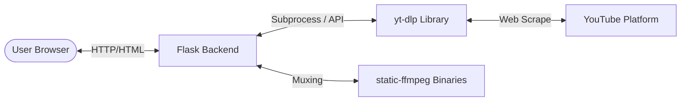

# Software Requirements Specification (SRS) - EveryThingDownloader

## 1. Technical Stack
- **Backend**: Python 3.12, Flask 3.0
- **Core Downloader Engine**: `yt-dlp` (Python-native YouTube/universal scraper and downloader)
- **Muxing/Merging Engine**: FFmpeg (loaded dynamically via python package `static-ffmpeg`)
- **Frontend**: HTML5, Vanilla CSS3 (custom futuristic styling, glassmorphism, animations), Vanilla JavaScript (ES6)
- **Icons**: Lucide Icons (CDN)
- **Fonts**: Google Fonts ("Space Grotesk" for headers, "Outfit" for body)

## 2. System Architecture
The application is structured as a single-page application (SPA). The Flask backend acts as a static web server and a JSON API server.



## 3. Functional Requirements

### 3.1 Link Verification & Processing
- The backend must accept standard YouTube links (`https://youtube.com/watch?v=...`), mobile links (`https://youtu.be/...`), and YouTube Shorts links (`https://youtube.com/shorts/...`).
- Custom validation is performed both on the frontend (regex check) and backend (handling extraction errors gracefully).

### 3.2 Backend API Specifications

#### 3.2.1 Get Video Info
- **Endpoint**: `/api/info`
- **Method**: POST
- **Content-Type**: `application/json`
- **Request Body**:
  ```json
  {
    "url": "https://www.youtube.com/watch?v=..."
  }
  ```
- **Response (Success - 200 OK)**:
  ```json
  {
    "status": "success",
    "title": "Video Title",
    "thumbnail": "https://i.ytimg.com/vi/.../maxresdefault.jpg",
    "duration": 185,
    "uploader": "Uploader Name",
    "formats": [
      {
        "format_id": "137+140",
        "resolution": "1080p",
        "ext": "mp4",
        "filesize": 45120300,
        "type": "video"
      },
      {
        "format_id": "22",
        "resolution": "720p",
        "ext": "mp4",
        "filesize": 25120300,
        "type": "video"
      },
      {
        "format_id": "bestaudio",
        "resolution": "128kbps",
        "ext": "mp3",
        "filesize": 4120300,
        "type": "audio"
      }
    ]
  }
  ```
- **Response (Error - 400/500)**:
  ```json
  {
    "status": "error",
    "message": "Invalid YouTube URL or downloader error details"
  }
  ```

#### 3.2.2 Download & Stream
- **Endpoint**: `/api/download`
- **Method**: GET or POST
- **Parameters / Request**:
  - `url`: String (YouTube URL)
  - `format_id`: String (yt-dlp format selection code)
  - `ext`: String (target extension, e.g. "mp4", "mp3")
- **Behavior**:
  1. Create a unique, temporary directory inside `downloads/temp_<uuid>/`.
  2. Invoke `yt-dlp` to download the specific `format_id` (and merge video+audio using the injected `ffmpeg` path if necessary).
  3. Stream the final file back to the browser using `flask.send_file` with the correct headers (attachment filename, content-length).
  4. Schedule a background thread or process to delete the temporary folder and its contents shortly after download completion or connection termination.

### 3.3 Non-Functional & Operational Requirements
- **Local Storage / Clean-up**: Downloads must not consume disk space permanently. After streaming the file, the server must wipe the temp download directory.
- **Portability**: The system must run on Windows without manual FFmpeg setup. The python package `static-ffmpeg` will download static binaries on first launch and set them in the OS `PATH` env programmatically.
- **User Interface Aesthetics**: A futuristic cyber/space look:
  - Background: dark base with shifting neon purple/blue glows.
  - Controls: glassmorphism cards, glowing box shadows, futuristic typography.
  - Buttons: animated gradient fills, scaling hover animations.
