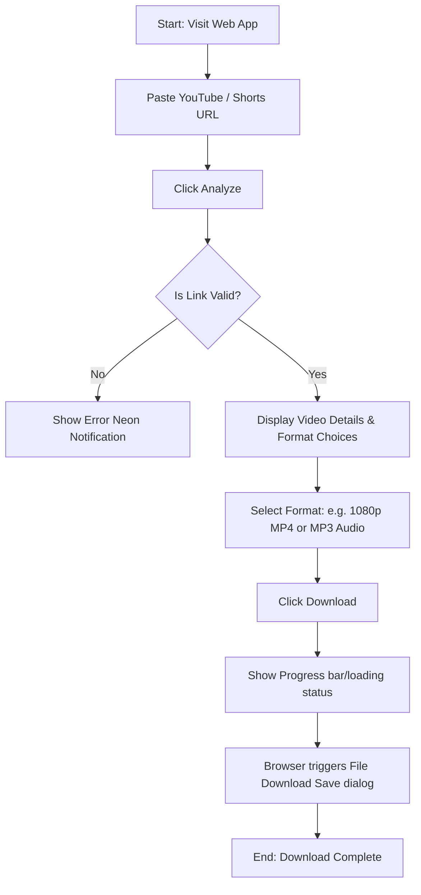

# User Requirements Document (URD) - EveryThingDownloader

## 1. Introduction
EveryThingDownloader is a web-based, self-hosted utility designed for downloading media files from online platforms directly to the user's device. The primary target for the initial phase is downloading videos and Shorts from YouTube.

## 2. Target Audience & Core Needs
- **Content Creators & Editors**: Need to download high-quality assets (up to 1080p, 2K, 4K) for compilation or reference.
- **Offline Viewers**: Users who want to download tutorials, educational videos, or music to watch/listen offline without internet.
- **General Public**: Users seeking a straightforward, reliable, and ad-free experience without clicking through malware-ridden generic downloader sites.

## 3. Key Requirements (User Perspective)
- **High-Quality Media**: Ability to select between different resolutions (1080p, 720p, 480p, 360p) and formats (MP4, MP3).
- **YouTube Shorts Support**: The downloader must accept Shorts URLs (e.g. `youtube.com/shorts/...`) and process them seamlessly like standard videos.
- **Modern, Futuristic Interface**: The website must look state-of-the-art with dark themes, glowing borders, smooth animations, and clear status feedbacks (no generic web forms).
- **Simple 3-Step Process**:
  1. Paste Link.
  2. Click "Analyze" and select format/quality.
  3. Click "Download".
- **Zero Ads or Redirects**: A clean utility tool with no popups or misleading download buttons.
- **No Account Required**: Instant utility without login.

## 4. User Experience & Flows

### 4.1 Interface Layout
- **Hero/Header**: Futuristic logo (EveryThingDownloader) with neon/glow design.
- **Input Center**: A styled glassmorphic input box where users paste the video link. It includes an auto-detection mechanism or a paste button.
- **Metadata Card**: Displays once the link is parsed. It includes:
  - Video thumbnail.
  - Video title, creator, and duration.
  - Interactive table/buttons to select and download different video resolutions and audio formats.
- **Progress Panel**: Displays loading spinners during analysis, and progress percentages during download.

### 4.2 User Flow Diagram

