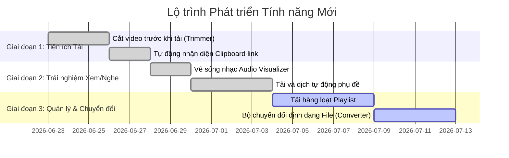

# Kế Hoạch Chi Tiết Phát Triển 6 Tính Năng Mới

Tài liệu này vạch ra thiết kế kiến trúc, các API cần thay đổi và lộ trình triển khai chi tiết cho 6 tính năng cao cấp của Meikova Harvest.

---

## 🛠️ Thiết Kế Chi Tiết Từng Tính Năng

### 1. Cắt Video/Audio trước khi tải (Video Trimmer) [ĐÃ HOÀN THÀNH]
*   **Mô tả**: Cho phép cắt và tải về một phân đoạn thời gian cụ thể thay vì tải toàn bộ file.
*   **Giao diện (UI/UX)**:
    *   Thêm hai nút chọn mốc thời gian **Start (Giây đầu)** và **End (Giây cuối)** trên thanh trượt của trình xem trước (Previewer).
    *   Tự động điền mốc thời gian khi người dùng nhấn phím nóng (Ví dụ: phím `[` chọn Start, phím `]` chọn End).
*   **Thay đổi API & Lập trình**:
    *   Gửi thêm 2 tham số `start_time` và `end_time` (kiểu float) lên API `/api/download/start`.
    *   Ở backend ([tasks/download.py](file:///d:/JOB/DEV/Meikova Harvest/tasks/download.py)), cập nhật lệnh gọi FFmpeg để chèn các cờ cắt nhanh:
        *   Sử dụng cờ `-ss <start_time>` và `-to <end_time>` đặt trước file đầu vào (để cắt nhanh không giải mã) hoặc đặt trước file đầu ra (để cắt chính xác khung hình keyframe).
        *   Ví dụ: `ffmpeg -ss 10 -to 45 -i input.mp4 -c copy output.mp4`

---

### 2. Tải Playlist & Hàng loạt (Playlist & Batch Downloader)
*   **Mô tả**: Phân tích link danh sách phát và cho phép tích chọn tải nhiều file cùng lúc.
*   **Giao diện (UI/UX)**:
    *   Khi phân tích một link Playlist, giao diện sẽ chuyển từ hiển thị 1 video đơn lẻ sang giao diện danh sách (Grid/List) có các ô checkbox, nút "Chọn tất cả" và nút "Tải các mục đã chọn".
*   **Thay đổi API & Lập trình**:
    *   Cập nhật API `/api/info` để nhận diện cấu trúc playlist của `yt-dlp`.
    *   Trong [routes/info.py](file:///d:/JOB/DEV/Meikova Harvest/routes/info.py), cấu hình `extract_flat: True` cho `yt-dlp` để lấy nhanh tiêu đề, hình thu nhỏ (thumbnail) của toàn bộ danh sách phát mà không cần truy vấn sâu từng video (tránh bị nghẽn mạng).
    *   Tạo hàng đợi tải xuống (Download Queue) ở Frontend để gửi tuần tự các yêu cầu tải đến backend, giúp quản lý băng thông và tiến độ tải từng file.

---

### 3. Bộ chuyển đổi định dạng File (Format Converter)
*   **Mô tả**: Chuyển đổi định dạng các file đã tải xuống thành công (Ví dụ: MP4 sang MP3, WebM sang MP4).
*   **Giao diện (UI/UX)**:
    *   Trong tab **Downloaded Files**, thêm nút **Convert** bên cạnh mỗi tệp. Khi nhấn, một modal nhỏ sẽ hiện lên cho phép chọn định dạng đầu ra (MP3, M4A, MP4 nén, MKV) và chất lượng.
*   **Thay đổi API & Lập trình**:
    *   Tạo API mới `@build_bp.route('/api/download/convert', methods=['POST'])`.
    *   Sử dụng FFmpeg để chuyển đổi định dạng ở chế độ bất đồng bộ:
        *   Tách nhạc: `ffmpeg -i video.mp4 -vn -acodec libmp3lame -q:a 2 audio.mp3`
        *   Chuyển định dạng: `ffmpeg -i video.webm -c:v libx264 -crf 23 -c:a aac video.mp4`
    *   Sau khi chuyển đổi thành công, cập nhật thông tin file mới vào SQLite Database (`downloads.db`) để hiển thị tệp mới trong danh sách.

---

### 4. Hiệu ứng sóng nhạc trực quan khi phát Audio (Waveform Visualizer) [ĐÃ HOÀN THÀNH]
*   **Mô tả**: Vẽ sóng nhạc động tương thích với tần số âm thanh thời gian thực.
*   **Giao diện (UI/UX)**:
    *   Vẽ một khung hình `<canvas>` động thay thế cho màn hình trống của trình nghe nhạc `preview-audio-container`.
*   **Thay đổi API & Lập trình (100% Frontend)**:
    *   Sử dụng **Web Audio API** của trình duyệt trong [static/js/main.js](file:///d:/JOB/DEV/Meikova Harvest/static/js/main.js):
        ```javascript
        const audioCtx = new (window.AudioContext || window.webkitAudioContext)();
        const analyser = audioCtx.createAnalyser();
        const source = audioCtx.createMediaElementSource(previewAudioPlayer);
        source.connect(analyser);
        analyser.connect(audioCtx.destination);
        ```
    *   Dùng hàm `requestAnimationFrame` để liên tục đọc dữ liệu tần số (`analyser.getByteFrequencyData`) và vẽ các cột sóng nhạc chuyển động nhịp nhàng trên màn hình `<canvas>`.

---

### 5. Tự động nhận diện Link trong Clipboard (Clipboard Auto-Detect) [ĐÃ HOÀN THÀNH]
*   **Mô tả**: Tự động phát hiện khi người dùng Copy link video để gợi ý tải ngay lập tức.
*   **Giao diện (UI/UX)**:
    *   Một góc nhỏ trên màn hình sẽ hiện thông báo dạng Toast dịu mắt: *"Phát hiện link video: [Tên Link]. Click để phân tích"*.
*   **Thay đổi API & Lập trình**:
    *   Trong file chạy chính của Electron ([electron/main.js](file:///d:/JOB/DEV/Meikova Harvest/electron/main.js)), thiết lập bộ kiểm tra Clipboard bằng API `clipboard`:
        ```javascript
        const { clipboard } = require('electron');
        setInterval(() => {
          const text = clipboard.readText();
          if (isValidVideoUrl(text)) {
            mainWindow.webContents.send('clipboard-link', text);
          }
        }, 1500);
        ```
    *   Ở Renderer process (`static/js/main.js`), lắng nghe sự kiện `clipboard-link` qua `ipcRenderer.on` để cập nhật trạng thái UI hoặc tự động điền vào ô nhập URL.

---

### 6. Tải Phụ đề & Dịch tự động (Subtitle Downloader & Translator) [ĐÃ HOÀN THÀNH]
*   **Mô tả**: Trích xuất phụ đề gốc của video hoặc dịch phụ đề tự động sang Tiếng Việt.
*   **Giao diện (UI/UX)**:
    *   Thêm menu lựa chọn phụ đề: "Không phụ đề", "Phụ đề gốc (chọn ngôn ngữ)", "Phụ đề dịch tự động sang Tiếng Việt".
    *   Cho phép tích chọn "Hardsub" (ghi đè chữ vào hình ảnh) hoặc "Softsub" (nhúng phụ đề bật tắt được).
*   **Thay đổi API & Lập trình**:
    *   API `/api/info` sẽ trả về danh sách phụ đề có sẵn trong trường `subtitles` và `automatic_captions` thu được từ `yt-dlp`.
    *   Ở backend, nếu người dùng yêu cầu phụ đề:
        *   Tải phụ đề `.vtt` / `.srt` tương ứng.
        *   *Dịch tự động*: Nếu chọn dịch sang Tiếng Việt, sử dụng một script dịch bất đồng bộ gửi yêu cầu dịch các khối văn bản của file phụ đề sang Tiếng Việt rồi ghi đè lại file.
        *   *Nhúng phụ đề*: Dùng FFmpeg với bộ lọc `-filter:v "subtitles=subtitle.srt"` để vẽ chữ trực tiếp lên video (Hardsub) hoặc nhúng luồng phụ đề vào container MP4/MKV (Softsub).

---

## 📅 Lộ Trình Triển Khai (Roadmap)

Kế hoạch được chia thành **3 Giai đoạn** chính để đảm bảo kiểm thử và chất lượng tối đa:



### Chi tiết các Giai đoạn:
1.  **Giai đoạn 1 (Tiện ích thông minh) [ĐÃ HOÀN THÀNH]**: Cắt video trước khi tải & Nhận diện clipboard. Đây là các tính năng cải thiện trực tiếp sự tiện dụng và tiết kiệm tài nguyên.
2.  **Giai đoạn 2 (Trải nghiệm đa phương tiện) [ĐÃ HOÀN THÀNH]**: Sóng nhạc Audio & Tải dịch phụ đề. Tăng tính thẩm mỹ cao cấp và giúp xem video nước ngoài dễ dàng.
3.  **Giai đoạn 3 (Quản lý nâng cao) [ĐANG TRIỂN KHAI]**: Playlist Downloader & File Converter. Hoàn thiện hệ sinh thái quản lý file của ứng dụng.

---

## 🎁 Tính Năng Bổ Trợ Đã Triển Khai (Ngoài Kế Hoạch Gốc)

Ngoài 6 tính năng trong lộ trình ban đầu, các tính năng cao cấp sau đã được xây dựng và tích hợp thành công:

| # | Tính năng | Mô tả | Module chính |
| :--- | :--- | :--- | :--- |
| 1 | **Bộ lọc màu Cinematic** | 4 preset màu chuyên nghiệp: Cyberpunk, Vintage, Noir, Enhance | `utils/ffmpeg.py` → `apply_cinematic_filter()` |
| 2 | **Xuất GIF & Shorts** | Chuyển đổi video → GIF động (palettegen) hoặc dọc 9:16 (nền mờ) | `utils/ffmpeg.py` → `convert_to_gif()`, `convert_to_shorts()` |
| 3 | **Audio EQ 4-band** | Cân bằng Bass 60Hz, Low-Mid 500Hz, High-Mid 2kHz, Treble 10kHz | `utils/ffmpeg.py` → `apply_audio_effects()` |
| 4 | **Thay đổi tốc độ phát** | Điều chỉnh 0.25x → 3x (chained atempo) | `utils/ffmpeg.py` → `apply_audio_effects()` |
| 5 | **Voice FX (8 preset)** | Deep, Bright, Hall, Studio, Lo-Fi, Telephone, Underwater | `utils/ffmpeg.py` → `apply_audio_effects()` |
| 6 | **Lồng tiếng AI (TTS)** | Edge-TTS song song 15 luồng, pha trộn PCM, overlay lên video | `utils/ffmpeg.py` → `overlay_voiceover_tts()` |
| 7 | **Tải lên Telegram** | Gửi video/GIF/file qua Telegram Bot API | `tasks/download.py` → `upload_to_telegram()` |
| 8 | **Dark/Light Mode** | Chuyển đổi chủ đề với View Transitions API (clip-path animation) | `main.js`, `styles.css` |
| 9 | **UI Customizer** | 10+ accent theme, glass blur, font, grid effects, sparkles | `main.js` → UI Customizer module |
| 10 | **Lịch sử tải xuống** | Lưu SQLite, xem lại/tải lại/xóa từng mục | `config.py` → `PersistentDownloadStatus` |
| 11 | **SoundCloud & Vimeo** | Mở rộng hỗ trợ nền tảng nhạc/video | `routes/info.py` |
| 12 | **Image Viewer** | Zoom 0.5x→5x, xoay 90°, kéo pan | `main.js` |
| 13 | **Image Filters & Bulk ZIP** | Chỉnh brightness/contrast/saturation/hue/sepia, tải ZIP nhiều ảnh | `routes/download.py` |
| 14 | **DASH Adaptive Preview** | FFmpeg mux on-the-fly video+audio → stream preview | `routes/download.py` → `/api/proxy/stream_adaptive` |
| 15 | **SSE Progress Stream** | Real-time download progress qua Server-Sent Events | `routes/download.py` → `/api/download/progress/<id>` |
| 16 | **DNS Bypass (DoH)** | Vượt chặn ISP qua DNS-over-HTTPS (Cloudflare, Google, AdGuard) | `extractors/generic.py` |
| 17 | **Smart Cookie Detection** | Tự động phát hiện cookie từ 6+ trình duyệt đã cài đặt | `utils/ytdl.py` |
| 18 | **Git Release Publisher** | Tạo tag/commit/push trực tiếp từ Build GUI | `routes/build.py` → `/api/build/publish` |
| 19 | **Scene Analysis** | Phân tích cảnh video bằng FFmpeg showinfo filter | `routes/info.py` → `/api/video/analyze-scenes` |
| 20 | **App Config Persistence** | Lưu cấu hình server-side vào `app_config.json` hoặc SQLite | `config.py` → `AppConfig` |
